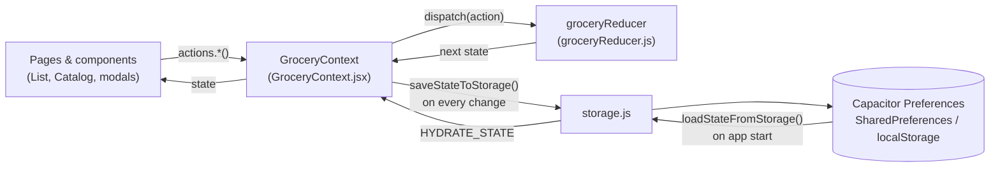
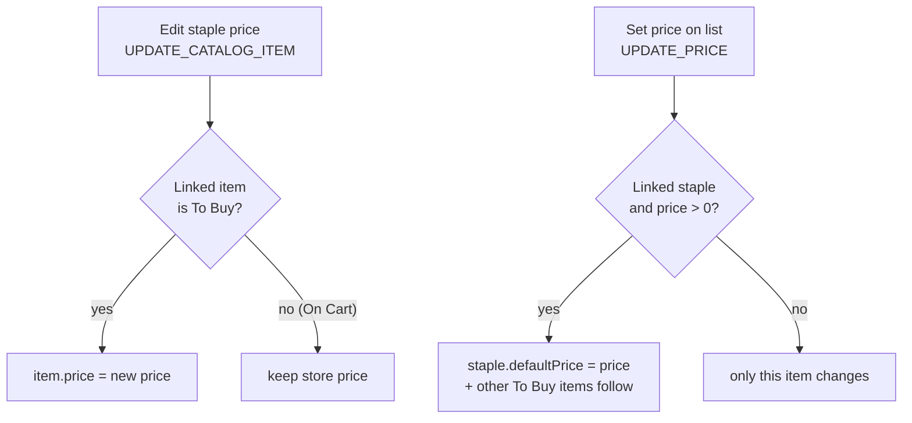
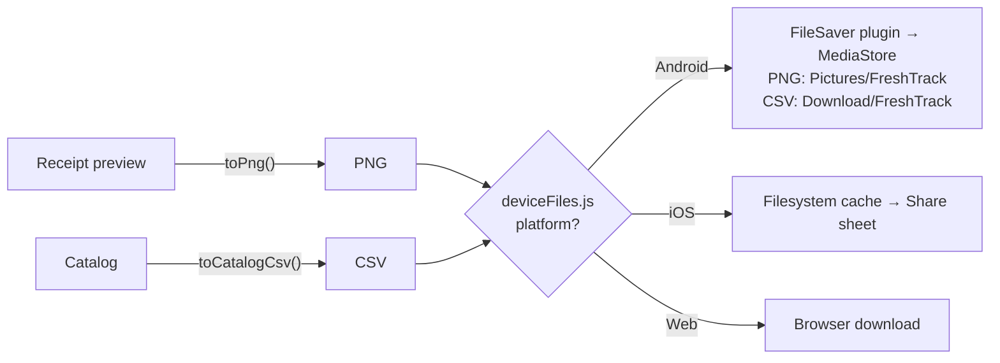
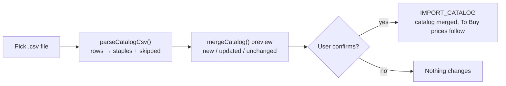

<div align="center">


# FreshTrack - Grocery List & Staples Catalog Tracker

**Track Your Daily Groceries, Batch-Add Staples, and Generate Digital Receipts in Seconds.**

A fast, offline-first grocery tracking mobile & web application designed to eliminate paper lists and help you manage your everyday grocery shopping with zero friction.

</div>

---

## 🛑 The Problem

Shopping for groceries with generic notes apps or paper lists creates several recurring headaches:
1. **Repetitive Typing**: Every week, you buy the same core staples (*Bananas, Rice, Milk, Garlic*), yet you have to manually type or copy-paste them from scratch each time.
2. **Volatile Browser Storage**: Standard mobile web apps rely on basic `localStorage`. When your Android device runs low on memory or you clear your browser cache, your entire grocery list gets permanently wiped.
3. **No Price/Quantity Verification or Receipts**: Basic to-do apps don't calculate subtotals (`price per unit × quantity`) on the fly or provide a clean, downloadable proof-of-purchase receipt to verify against actual store checkouts.
4. **Tedious Mobile APK Builds**: Building and sharing standalone mobile Android APKs with family members or testers usually requires heavy local Android Studio setups and manual release uploading.

---

## 💡 Why Use FreshTrack?

FreshTrack solves these problems by combining modern web ergonomics with native Android offline persistence and automated CI/CD:

- **📚 Frequently Bought Staples Catalog**: Stop typing from scratch. Save your everyday groceries (with an optional default price) into your personal **Staples Catalog**, select several at once, and batch-add them to your daily list in one tap. Staples already on today's list are marked **On list**.
- **📤 Catalog Import / Export (CSV)**: Back up your staples or build the list in Excel / Google Sheets, then import it back. Imports merge into your catalog and show a summary before anything changes.
- **🔗 Linked Prices**: Catalog prices and list prices stay in sync. Change a staple's price and its "To Buy" items follow; confirm a new price at the store and it becomes the staple's default for next time.
- **⚡ 100% Offline-First Native Storage (`@capacitor/preferences`)**: Your items and catalog are saved to native **Android SharedPreferences** (with a `localStorage` fallback on web). Your data survives browser cache sweeps and is instantly available offline.
- **🧾 Full-Screen Digital Receipt Generator**: When you finish shopping, tap **Generate Receipt** to open a full-screen receipt of everything on your cart, then download it as a timestamped PNG (`FreshTrack_Receipt_YYYY-MM-DD_HHmmss.png`). On Android it's saved straight to your Gallery (**Pictures/FreshTrack**).
- **🔔 In-App Update Checker**: The app checks GitHub for a newer release and offers to download the new APK.
- **🤖 Automated GitHub Android APK Releases**: Push a version tag (`v*`) and GitHub Actions builds the web bundle, syncs Capacitor, compiles `app-debug.apk`, reads `CHANGELOG.md`, and publishes a GitHub Release with the APK attached.

---

## 🔗 Links & Documentation

- **Changelog**: [View CHANGELOG.md](CHANGELOG.md) — *Release notes and version history.*
- **Architecture & ADRs**: [Offline Storage & Release Workflow One-Pager](docs/ideas/offline-storage-and-github-release.md) — *Technical breakdown of our Capacitor SharedPreferences storage and CI/CD decisions.*
- **Data Contracts**: [src/types/contracts.js](src/types/contracts.js) — *JSDoc types for every stored object (see [Data Schema](#-data-schema)).*
- **Package Contract**: [package.json](package.json) — *Single source of truth for the app version and dependencies.*

---

## ⚙️ Functions

### 🧑 User can

**Daily List** (`/`)
- Add items to the list by picking one or more staples in the **Add Item** sheet, or create a new staple right there with **New** (it's auto-selected).
- Tick an item to put it **On Cart**: a price sheet opens to enter the **price per piece** and **quantity**, with a live computed total.
- Untick an item to move it back to **To Buy**.
- Change quantity with the **− / +** stepper, or tap the number to type it.
- Rename an item with the pencil icon (and edit its price when it's on the cart).
- Remove an item (with confirmation), or clear a whole section with **Clear to buy** / **Clear on cart**.
- Sort the list: default order, **Name A → Z**, or **Name Z → A**.
- See shopping progress (`checked / total`, `%`) and the running **On Cart Total**.
- Open the cart drawer and **Generate Receipt**.

**Staples Catalog** (`/catalog`)
- Add a staple with a name and an optional default price per piece (**Add Staple**).
- Search staples by name and sort them.
- Select staples one by one or with **Select all** (it only selects the staples matching the current search), then **Add to List**.
- Edit a staple's name and default price.
- **Export the catalog to CSV** from the **⋯** menu: saved to **Download/FreshTrack** on Android, a normal download on the web.
- **Import staples from a CSV** (⋯ menu, or the empty catalog screen), review the summary (new / price updates / unchanged / skipped), then confirm.
- Remove a staple (with confirmation).
- See which staples are already **On list**, and how many.

**Digital Receipt**
- Preview a receipt of all on-cart items: quantities, unit prices, subtotals, item/piece counts and grand total.
- **Download Receipt (PNG)**: saved to **Pictures/FreshTrack** on Android, a normal download on the web.
- **Share** the receipt image to another app (mobile app only).

**App**
- Switch pages from the bottom nav or the sidebar menu (which shows item / staple counts).
- Check for and download app updates (**Update Available** in the sidebar).

### 🤖 System can

- **Persist everything offline**: every state change is saved to Capacitor Preferences (Android SharedPreferences / web `localStorage`) under one key, and restored on app start.
- **Seed a first-run list**: when nothing is saved yet, the app starts with sample items so it isn't empty.
- **Link list items to staples**: items added from the catalog store the staple's `catalogId`. Older or hand-typed items are matched by name (ignoring case and spaces), and gain the `catalogId` the first time they sync, so renaming a staple keeps the link.
- **Sync prices both ways**:
  - Staple price edited → linked **To Buy** items take the new price. **On Cart** items keep the price you confirmed at the store, and a rename without a price change leaves list prices alone.
  - List price set (Mark on Cart / inline edit) → the linked staple's `defaultPrice` updates, and other linked **To Buy** items follow. A cleared price (`₱0`) never wipes the staple's default.
- **Read and write catalog CSV files**:
  - Export writes `name,defaultPrice` with a UTF-8 BOM (so Excel shows ₱ and accented names correctly), quotes names containing commas or quotes, and prefixes names starting with `= + - @` with `'` so spreadsheets don't run them as formulas.
  - Import accepts files with or without a header row (`name`/`item`, `defaultPrice`/`price`), prices like `₱1,200.50` or `PHP 110`, and any line endings. Rows with no name or an invalid/negative price are skipped; a name repeated in the file keeps its last row.
  - Merging matches names ignoring case and spaces: new names are added, matching staples take the file's price (a blank price keeps the current one), and nothing is deleted. Linked **To Buy** items follow the new prices, same as editing a staple.
- **Calculate totals live**: item total (`price × quantity`), On Cart Total, progress percentage, and receipt totals.
- **Generate the receipt image**: render the receipt to a 2× PNG (`html-to-image`) with a timestamped filename.
- **Save to the device**: on Android 10+ via `MediaStore` (no permission needed); on Android 7–9 by asking once for storage permission. iOS falls back to the share sheet.
- **Check for updates**: compare `package.json`'s version with the latest GitHub release when online, show the update prompt at most once every 24 hours (or immediately on a manual check).
- **Build & release automatically**: on a `v*` tag, GitHub Actions builds the APK and publishes a release using the top `CHANGELOG.md` section as notes.

---

## 🗂️ Data Schema

All app data lives in one JSON object (`GroceryState`), defined as JSDoc types in [`src/types/contracts.js`](src/types/contracts.js). There is no backend.

### `GroceryState`
| Field | Type | Description |
| --- | --- | --- |
| `items` | `GroceryItem[]` | Today's shopping list (both "To Buy" and "On Cart"). |
| `catalog` | `CatalogItem[]` | The user's saved staples. Optional; treated as `[]` when missing. |

### `GroceryItem` (list item)
| Field | Type | Required | Rules / Default | Description |
| --- | --- | --- | --- | --- |
| `id` | `string` | ✅ | `generateId()` | Unique item id. |
| `name` | `string` | ✅ | trimmed, non-empty | Item name. |
| `isChecked` | `boolean` | ✅ | `false` | `false` = **To Buy**, `true` = **On Cart**. |
| `quantity` | `number` | — | `1` | Number of pieces. |
| `price` | `number` | — | `0`, never negative | Price **per piece** (₱). Item total = `price × quantity`. |
| `catalogId` | `string` | — | set when added from / synced with the catalog | Id of the linked `CatalogItem`. |

### `CatalogItem` (staple)
| Field | Type | Required | Rules / Default | Description |
| --- | --- | --- | --- | --- |
| `id` | `string` | ✅ | `generateId()` | Unique staple id. |
| `name` | `string` | ✅ | trimmed, non-empty | Staple name. |
| `defaultPrice` | `number` | — | `0`, never negative | Default price per piece, copied into `GroceryItem.price` when added. |

### Example
```json
{
  "items": [
    { "id": "a1", "name": "Whole Milk", "isChecked": true, "quantity": 2, "price": 110, "catalogId": "c1" },
    { "id": "a2", "name": "Garlic", "isChecked": false, "quantity": 1, "price": 0 }
  ],
  "catalog": [
    { "id": "c1", "name": "Whole Milk", "defaultPrice": 110 }
  ]
}
```

### Storage keys (Capacitor Preferences)
| Key | Value |
| --- | --- |
| `freshtrack_grocery_state_v1` | The whole `GroceryState`, as JSON. |
| `lastUpdateCheck` | Timestamp (ms) of when the update prompt was last dismissed, for the 24h cooldown. |

> Receipt images and catalog exports are **not** stored in app state. They are written to the device (`Pictures/FreshTrack` and `Download/FreshTrack` on Android) or downloaded by the browser.

### Catalog CSV file
Import / export format for the Staples Catalog (only `name` is required):
```csv
name,defaultPrice
Whole Milk,110
"Rice, Jasmine 5kg",385.5
Garlic,
```
| Column | Also accepted as | Rules |
| --- | --- | --- |
| `name` | `item`, `item name`, `staple` | Required. Rows without a name are skipped. |
| `defaultPrice` | `price`, `price per piece`, `unit price` | Optional, ₱ per piece. Blank = keep the current price (new staples get `0`). `₱`, `PHP` and thousands commas are allowed. |

---

## 🔄 Data Flow

FreshTrack uses a single React context + reducer as its store. UI components never write to storage directly; they call an action, the reducer returns the next state, and a side effect persists it.



### 1. App start
1. `GroceryProvider` starts with the sample `seedState` ([`seedData.js`](src/data/seedData.js)).
2. `loadStateFromStorage()` reads `freshtrack_grocery_state_v1`. If it exists, `HYDRATE_STATE` replaces the seed with the saved data.
3. Only after hydration does saving begin, so a slow load can never overwrite saved data with the seed.

### 2. Everyday changes
Every user action maps to one reducer action, and the result is saved automatically:

| User action | Reducer action |
| --- | --- |
| Add staples to the list | `BATCH_ADD_TO_LIST` (copies `name`, `defaultPrice → price`, `id → catalogId`) |
| Tick / untick an item | `UPDATE_PRICE` + `UPDATE_QUANTITY` + `TOGGLE_ITEM` (price sheet), or `TOGGLE_ITEM` |
| Change quantity / rename / remove | `UPDATE_QUANTITY` / `RENAME_ITEM` / `REMOVE_ITEM` |
| Clear sections | `CLEAR_UNCHECKED` / `CLEAR_CHECKED` |
| Add / edit / remove a staple | `ADD_TO_CATALOG` / `UPDATE_CATALOG_ITEM` / `REMOVE_FROM_CATALOG` |
| Import a catalog CSV | `IMPORT_CATALOG` (merge via `mergeCatalog()`) |

### 3. Catalog ↔ List price sync
Both directions are handled inside the reducer, so the list and the catalog are always updated in the same state change. `findCatalogItemFor()` finds an item's staple (by `catalogId`, then by name).



### 4. Receipt & catalog export
Both exports go through [`deviceFiles.js`](src/utils/deviceFiles.js), which picks the right destination per platform. On Android it calls the native `FileSaver` plugin ([`FileSaverPlugin.java`](android/app/src/main/java/com/freshtrack/grocery/FileSaverPlugin.java)), which writes through `MediaStore`.



### 5. Catalog import


### 6. Update check
On start (when online), `UpdateContext` fetches the latest GitHub release and compares its tag with `package.json`'s `version`. If it's newer, the sidebar shows **Update Available**, and the prompt appears at most once per 24 hours.

---

## 🛠️ How to Use & Get Started

### 1. Running Locally (Web Dev Server)
Prerequisites: **Node.js 22+** (Required by Capacitor 8 CLI)
```bash
# Clone or open the project repository
cd grocery-list-app

# Install dependencies
npm ci

# Start the lightning-fast Vite development server
npm run dev
```
Open your browser at `http://localhost:5173`. Switch between **List** and **Catalog** with the bottom nav or the hamburger menu.

```bash
# Run the test suite and linter
npm test
npm run lint
```

### 2. Building & Testing Android APK Locally
Prerequisites: **Java JDK 21** (Required by Capacitor 8 Android plugins) and **Android SDK** (or Android Studio)
```bash
# 1. Build the production web bundle
npm run build

# 2. Sync web assets & plugins to the native Android folder
npx cap sync android

# 3. Compile the standalone debug APK using Gradle
cd android
./gradlew assembleDebug

# Your ready-to-install APK will be generated at:
# android/app/build/outputs/apk/debug/app-debug.apk
```

### 3. Publishing an Automated Android APK Release on GitHub
The version lives in `package.json`. The release workflow reads it for the release name, and installed apps compare against it to detect updates, so **bump it for every release**.

```bash
# 1. Add a new "## [x.y.z] - YYYY-MM-DD" section at the TOP of CHANGELOG.md
#    (the workflow uses the first "##" section as the release notes)

# 2. Bump the version (patch = fixes, minor = new features), commit and tag
npm version minor        # updates package.json, commits "x.y.z" and tags vx.y.z

# 3. Push the commit and the tag
git push origin main
git push origin --tags
```
Within minutes, GitHub Actions will:
1. Build the frontend assets and sync Capacitor (`npx cap sync android`).
2. Run Gradle to compile `app-debug.apk`.
3. Extract the version from `package.json` and the release notes from `CHANGELOG.md`.
4. Publish a GitHub Release with the downloadable `.apk`, which installed apps will then offer as an update.

---

## 🧰 Tech Stack & Architecture

- **Core Framework**: [React 19](https://react.dev/) + [Vite 8](https://vitejs.dev/) + [React Router 7](https://reactrouter.com/) (`HashRouter`)
- **Styling & UI**: [Tailwind CSS v4](https://tailwindcss.com/) + [Lucide Icons](https://lucide.dev/) + [Framer Motion](https://motion.dev/)
- **State**: React Context + `useReducer` ([`GroceryContext.jsx`](src/store/GroceryContext.jsx), [`groceryReducer.js`](src/store/groceryReducer.js))
- **Mobile Bridge & Storage**: [Capacitor 8](https://capacitorjs.com/) (`@capacitor/preferences`, `@capacitor/filesystem`, `@capacitor/share`, `@capacitor/network`, `@capacitor/android`) + a custom native `FileSaver` plugin for saving to Pictures / Downloads
- **Image Generation**: [`html-to-image`](https://github.com/bubkoo/html-to-image) for high-fidelity PNG digital receipts
- **Testing & Quality**: [Vitest](https://vitest.dev/) + [Testing Library](https://testing-library.com/) (`npm test`), [Oxlint](https://oxc.rs/) (`npm run lint`)
- **CI/CD Automation**: GitHub Actions (`softprops/action-gh-release@v2`)

---

<div align="center">
  <sub>Built with ❤️ following advanced UI engineering and architecture standards.</sub>
</div>
